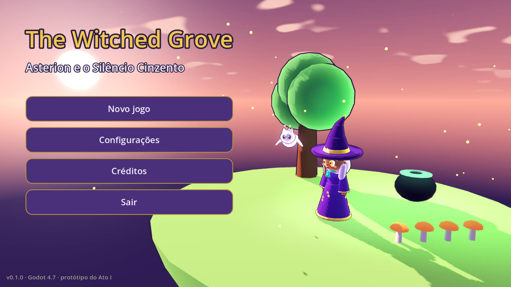
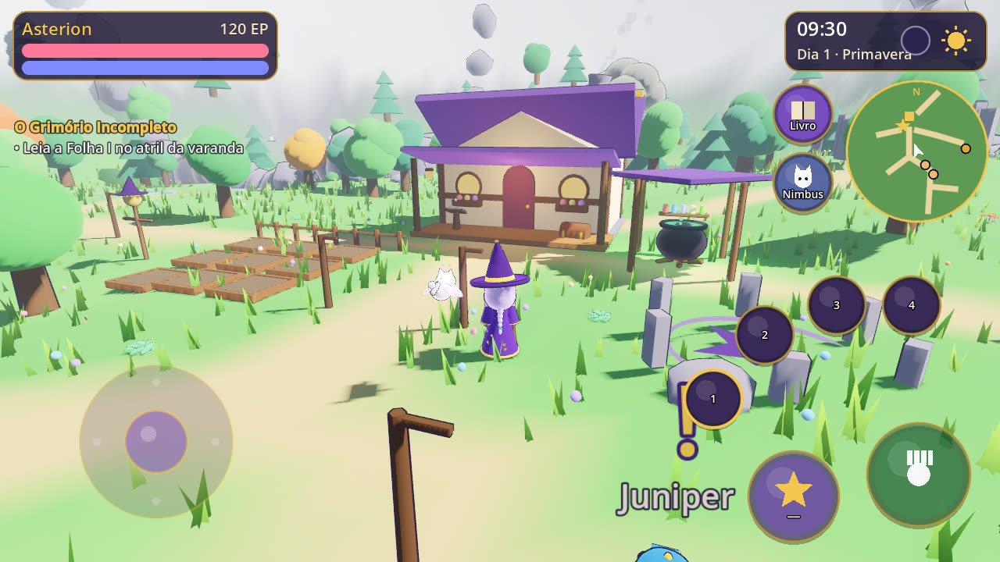
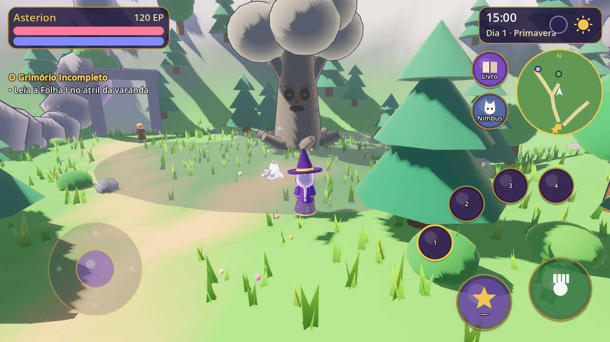
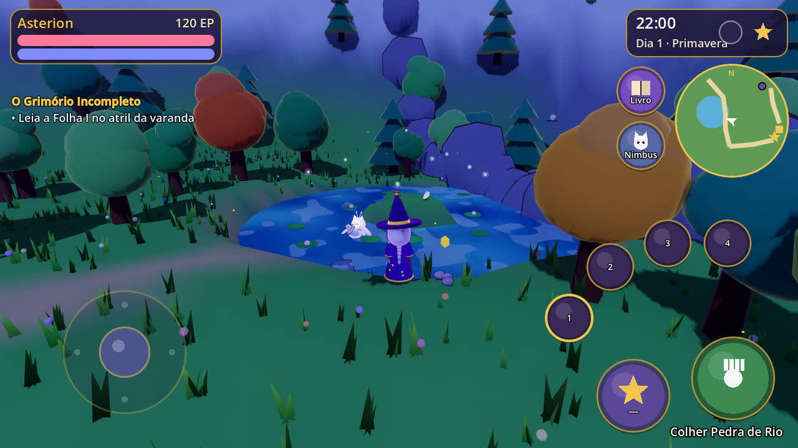
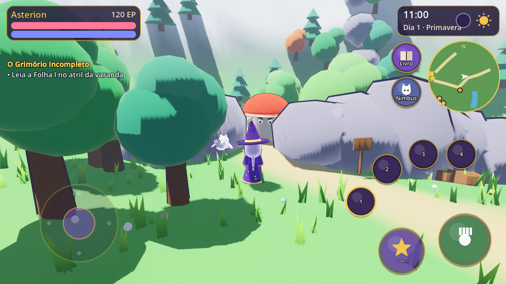
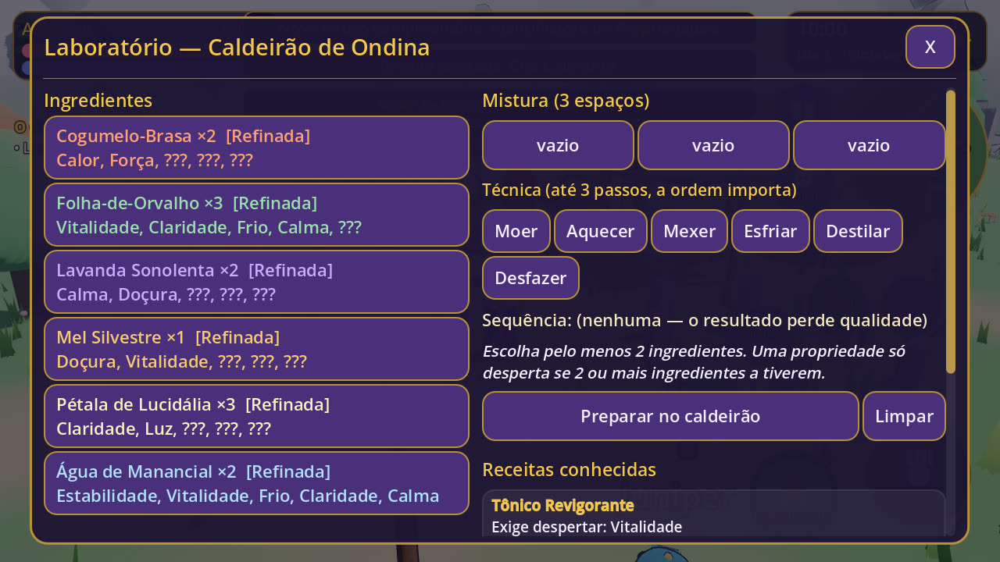
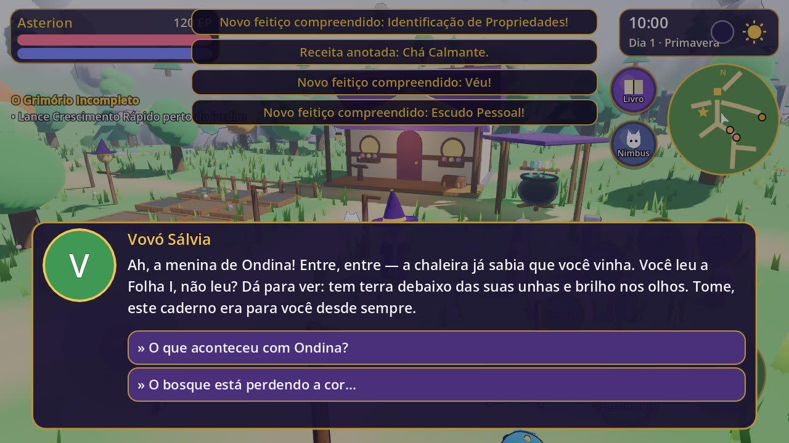
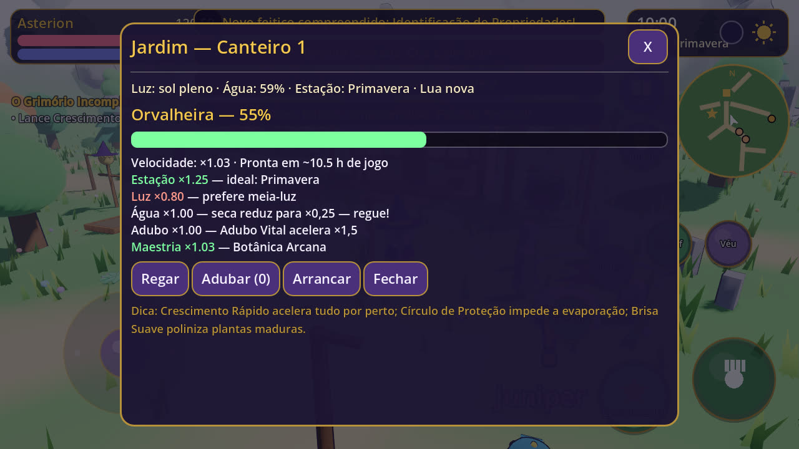
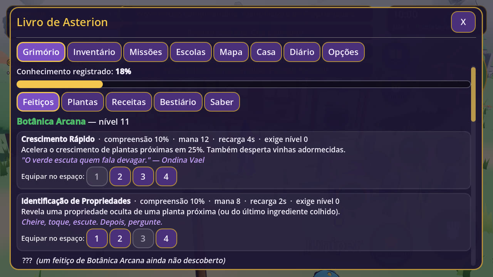
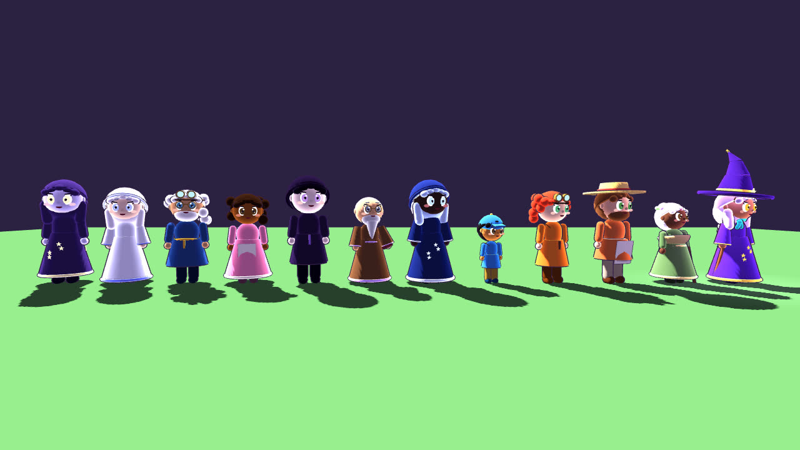

# The Witched Grove — *Asterion e o Silêncio Cinzento*

RPG 3D de bruxaria para **Android** feito em **Godot 4.7.2 + GDScript**, em estilo cartoon.
Você é **Asterion**, aprendiz de uma bruxa que sumiu na noite do eclipse. O bosque está perdendo a cor.
Não há espadas: você progride **estudando, experimentando, cultivando e escolhendo**.



| | |
|---|---|
|  |  |
|  |  |
|  |  |
|  |  |



> Todas as imagens são capturas do próprio protótipo. Personagens, cenários, música e sons foram
> **gerados em código** para este projeto — nenhum asset de terceiros.

---

## O que já dá para jogar (protótipo do Ato I)

- **Vale dos Sussurros** completo: cabana com biblioteca, laboratório, jardim 3×3, círculo ritual e cama;
  fonte e casa de chá, carroça do mercador, acampamento rival, santuário, árvore do Guardião, portal das
  ruínas, salgueiro oco, lagoa com ilhota, bosque das corujas, círculo de pedras e recanto do gelo.
- **8 NPCs** com rotina por horário, diálogos ramificados e memória das suas decisões; Nimbus, o
  gato-mariposa familiar, dá dicas contextuais.
- **16 feitiços funcionais** em 8 escolas que **mudam o mundo**: queimar sarças, despertar uma ponte de
  vinhas, congelar a lagoa, revelar marcas estelares, acalmar luméculas, purificar o Silêncio Cinzento…
- **Alquimia por propriedades**: 24 ingredientes, 15 propriedades, anulações, técnica em sequência,
  qualidade, receitas descobertas por experimentação e intuições que explicam cada falha.
- **Botânica**: estações, luz, água, adubo, lua, polinização e propagação — tudo explicado na tela.
- **8 missões** com **múltiplos desfechos** (curar o Guardião com alquimia, com contra-magia ou com o
  atalho sombrio de Kael — que tem consequências permanentes).
- Ciclo **dia/noite**, **estações**, **fases da lua** e **clima** determinístico.
- Casa com 6 cômodos que alteram mecânicas; economia sem arbitragem; reputação com 6 facções.
- Interface mobile: joystick + câmera com **multitoque**, botões grandes, 3 tamanhos de texto,
  alto contraste, vibração; salvamento automático ao minimizar o app.

## Como rodar

1. Instale o **Godot 4.7.2** (versão padrão, não .NET).
2. Abra o `project.godot` e pressione **F5**.
   - Desktop: **WASD** anda, arrastar o mouse gira a câmera, **E** interage, **Q** lança, **1–4** escolhem
     o feitiço, **Tab** abre o livro, **H** pede dica ao Nimbus, roda do mouse dá zoom.
   - Celular: joystick à esquerda, arraste à direita para a câmera, pinça para zoom.

### Exportar para Android
1. Instale os *export templates* 4.7.2 e configure o Android SDK no editor.
2. Crie uma keystore (`keytool -genkeypair …`) e preencha em **Projeto → Exportar → Android**
   (credenciais ficam em `export_credentials.cfg`, ignorado pelo git).
3. O preset já vem com arm64-v8a + armeabi-v7a, imersivo, vibração e `data/*.json` incluídos.

## Testes

```bash
godot --headless --import                                   # 1ª vez
godot --headless res://tests/test_runner.tscn               # 74 testes de sistemas e rotas do Ato I
godot --headless res://tests/smoke_world.tscn               # joga o Ato I no mundo 3D (44 checagens)
python3 tools/data_validator.py --pares                     # integridade dos dados + simulação do caldeirão
```

O GitHub Actions (`.github/workflows/tests.yml`) roda tudo a cada push.

## Ferramentas

| Ferramenta | Uso |
|------------|-----|
| `tools/gen_audio.py` | Regenera as 3 músicas, 3 ambiências e 29 efeitos (numpy + ffmpeg). |
| `tools/data_validator.py` | Valida JSON e lista combinações do caldeirão. |
| `tools/screenshot.gd` | Capturas automáticas (`-- <cena> <saida.png> [frames] [hora] [câmera] [painel]`). |
| `tools/preview_characters.tscn` | Desfile de todos os personagens. |

## Estrutura

```
src/autoload/     EventBus, DataRegistry, Settings, Game, SaveManager, AudioManager
src/scripts/      lógica pura (magic, alchemy, botany, progression, game, npc, inventory)
                  + mundo (world), personagens (character), interface (ui), efeitos (effects)
src/scenes/       menu, mundo, HUD
src/resources/    shaders (céu, água, grama, folhagem)
data/             TODO o conteúdo de design em JSON (feitiços, ingredientes, receitas, plantas,
                  NPCs, diálogos, missões, regiões, facções, casa, criaturas, páginas)
assets/audio/     música e efeitos gerados
tests/            unidade, integração e fumaça do mundo 3D
docs/             GDD e documentação técnica
```

## Documentação

[GDD](docs/01-design.md) · [Arquitetura](docs/02-arquitetura.md) · [Sistemas](docs/03-sistemas.md) ·
[Mundo](docs/04-mundo.md) · [Narrativa](docs/05-narrativa.md) · [Arte e Áudio](docs/06-arte.md) ·
[Balanceamento](docs/07-balanceamento.md) · [**Rule Engine**](docs/rule-engine.md) (decisões, fórmulas, propostas pendentes)
